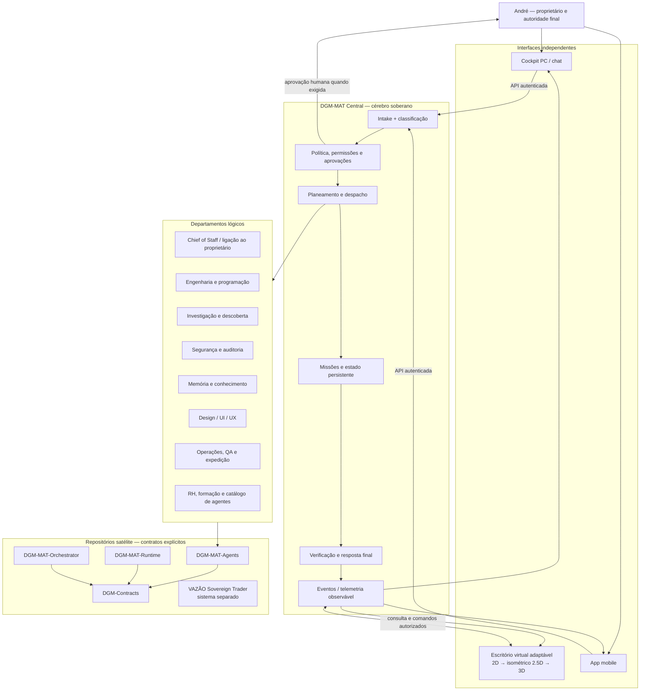

# DGM-MAT — Esquemática Integral do Escritório Virtual e Cockpit

**Data:** 2026-10-21  
**Estado:** blueprint de implementação; separa capacidades confirmadas, contratos e trabalho futuro  
**Autoridade:** subordinado à Constituição Arquitetural DGM-MAT de 2026-10-18 e ao Modelo Canónico de Operação de 2026-10-21.

## 1. Objetivo

Este documento transforma a visão do escritório virtual numa arquitetura implementável, com fronteiras, fluxos, módulos, estados, fases e critérios de aceitação. Não afirma que as partes futuras já estejam implementadas.

A esquemática SVG associada é uma planta de arquitetura, não telemetria em direto. A interface só pode mostrar atividade observada através dos contratos reais do DGM-MAT.

## 2. Diagrama geral

Ver [esquemática SVG](assets/dgm-mat-virtual-office-system-schematic.svg).

O diagrama representa fronteiras lógicas e direção de dependências, não prova que todos os conectores ou serviços satélite já estejam operacionais.

## 3. Camadas e responsabilidades

| Camada | Responsabilidade | Não pode fazer |
|---|---|---|
| Proprietário humano | Define objetivos, autoriza operações sensíveis, decide exceções e publicação | Ser substituído por uma decisão automática do agente |
| Cockpit PC | Conversa, pedidos, anexos permitidos, acompanhamento, aprovações e diagnóstico | Ser a fonte de verdade ou declarar execução só por receber uma resposta |
| Escritório virtual | Projetar estado real, departamentos, missões e agentes observados | Inventar agentes, atividade, progresso, métricas ou resultados |
| App mobile | Acesso remoto com os mesmos contratos e permissões do PC | Criar um segundo cérebro ou contornar aprovações |
| DGM-MAT Central | Missões, política, despacho, persistência, memória canónica, coordenação e verificação final | Delegar autoridade soberana para um departamento |
| Departamentos | Executar capacidades delimitadas, manter filas próprias e reportar resultados | Alterar política central ou autoaprovar elevação de privilégios |
| DGM-MAT-Agents | Implementações de agentes especializados | Importar módulos privados `core.*` ou iniciar outro orquestrador |
| DGM-Contracts | Modelos públicos, eventos e portas de serviço partilhadas | Conter lógica exclusiva de runtime ou acoplar-se à interface |
| Runtime / Orchestrator satélites | Capacidades modulares de execução e coordenação conforme contratos publicados | Ser fundidos no core por conveniência de build |
| VAZÃO Sovereign Trader | Sistema e escritório independentes | Ser tratado como departamento interno do DGM-MAT sem contrato/decisão explícita |

## 4. Fluxo operacional end-to-end

1. **Receção:** o utilizador envia pedido pelo cockpit PC ou mobile; o servidor atribui IDs de correlação e regista a mensagem.
2. **Classificação:** o DGM-MAT separa pedido, contexto, proposta de IA e instruções que exigem clarificação.
3. **Planeamento:** cria plano com tarefas, dependências, riscos, orçamento de recursos e departamentos envolvidos.
4. **Governação:** valida capacidades e permissões. Operações sensíveis ficam à espera de aprovação humana explícita.
5. **Despacho:** atribui tarefas a agentes reais registados, com identidade estável, limites e timeout.
6. **Execução:** agentes usam contratos e serviços injetados; cada ação observável produz evento/correlation ID.
7. **Persistência:** estados e checkpoints sobrevivem à perda do cockpit e permitem recuperação após reinício.
8. **Verificação:** resultados são avaliados contra critérios e evidências; “tentado”, “aceite”, “executado” e “validado” são estados diferentes.
9. **Entrega:** DGM-MAT agrega resultados e comunica o que passou, falhou, ficou bloqueado ou permanece desconhecido.
10. **Projeção:** cockpit, mobile e escritório leem a mesma fonte de verdade. Nenhuma animação é evidência de execução.

## 5. Contrato de estado e atividade

### Estados de missão

`draft → sent → accepted → approval_pending → queued → running → succeeded | failed | cancelled | blocked | unknown`

Nem todas as missões percorrem todos os estados. A API deve expor o estado real e timestamps; clientes não devem inferir sucesso a partir de HTTP 200, de uma resposta textual ou de um `mission_id`.

### Estados de departamentos e agentes

- `active`: existe atividade recente observada e correlacionada.
- `waiting`: existe uma dependência, aprovação ou tarefa em espera, com fonte explícita.
- `idle`: telemetria válida confirma ausência de trabalho atribuído.
- `degraded`: o serviço responde, mas comunica limitações concretas.
- `unknown`: não existe fonte atual suficiente.
- `offline/unavailable`: fonte indisponível ou heartbeat expirado, distinguido de idle.

O atual endpoint `/runtime/office/telemetry` é observacional e minimiza conteúdo. A telemetria existente ainda declara departamentos `research`, `memory` e `agents` como `unknown` quando não existe feed específico. Não transformar esses valores em “ativo” apenas para tornar o escritório mais vivo.

### Eventos mínimos recomendados

Cada evento deve ter `schema_version`, `event_id`, `timestamp`, `source`, `correlation_id`, entidade alvo, tipo, estado anterior/novo quando aplicável e referência a evidência. Conteúdo sensível, credenciais e corpo integral de conversas não pertencem à telemetria visual por defeito.

## 6. Organização física/visual do edifício

### Piso 0 — Receção e controlo
- Receção de pedidos, caixa de entrada e triagem.
- Chief of Staff: comunicação com o proprietário, perguntas, resumos e escalamento.
- Painel de aprovações e decisões pendentes.
- Ecrã de saúde real do core, API, worker e conectores.

### Piso 1 — Direção central
- Gabinete do cérebro DGM-MAT.
- Planeamento, prioridades, orçamento de recursos e quadro global de missões.
- Sala de coordenação interdepartamental.
- Gabinete visual do CEO/proprietário (representação pessoal).

### Piso 2 — Engenharia e produção
- Programação por linguagem/stack, revisão de código, correção e integração.
- Equipas temporárias multiagente para missões complexas.
- QA, testes, validação e integração de entregáveis.

### Piso 3 — Investigação e laboratórios
- Pesquisa web/documental, comparação de fontes e avaliação de providers.
- Laboratório de modelos locais e cloud, com custos/limites visíveis.
- Sandboxes isoladas; nenhum experimento ganha permissão de produção automaticamente.

### Piso 4 — Memória e conhecimento
- Recuperação e reconciliação de conversas/fontes.
- Separação entre pedidos do proprietário, sugestões da IA, decisões confirmadas e escolhas superadas.
- Proveniência, datas, versões e ligações aos repositórios.

### Piso 5 — Segurança, governação e auditoria
- Políticas, permissões, aprovações, auditoria de ações e gestão de incidentes.
- Revisão de dependências, segredos e superfícies de execução.
- Operações destrutivas exigem confirmação e plano de recuperação.

### Piso 6 — Design, produto e UI/UX
- Pesquisa de utilizador, design system, protótipos, acessibilidade e qualidade visual.
- Cockpit PC como prioridade; mobile como cliente correspondente.
- Renderizador adaptativo 2D/2.5D/3D sem alterar o significado do runtime.

### Piso 7 — RH, formação e catálogo de agentes
- Registo e descoberta de agentes, especialidades, versão, ferramentas e limites.
- Formação/testes em sandbox, revisão de qualidade e ciclo de vida.
- Agentes existentes podem ser visualizados como pessoas; agentes criados pelo DGM-MAT podem ser representados como robôs, sempre identificados por registo real.
- Recrutar/criar um agente não lhe concede permissões automaticamente.

### Piso 8 — Operações, armazém e expedição
- Filas de trabalho, artefactos produzidos, controlo de qualidade e entregas.
- Enfermaria/sala de recuperação para tarefas bloqueadas, retries seguros e incidentes.
- Armazém apenas contém artefactos realmente persistidos e com proveniência.

Os pisos são áreas lógicas configuráveis, não processos nem máquinas obrigatoriamente separados. A distribuição física por PCs adicionais vem depois de contratos, heartbeat, autenticação e recuperação estarem comprovados.

## 7. CEO: fotografia de referência e identidade visual

**Imagem de referência canónica no repositório DGM-MAT, branch `main`:** `1792476724975.jpg` (raiz do repositório).

Requisitos vinculativos para o avatar do escritório:
1. Usar a fotografia como referência de identidade facial e semelhança; não substituir por uma pessoa genérica.
2. A fotografia existente foi alterada por IA para mostrar cabelo. A representação oficial do CEO no escritório deve respeitar a descrição do proprietário: **careca**, mantendo semelhança facial com a fotografia.
3. Não inferir nem inventar idade, origem, uniforme, estatuto ou traços não sustentados pela referência.
4. Manter o ficheiro original intacto. Qualquer avatar derivado deve ser um novo asset versionado, por exemplo `docs/future/assets/ceo-avatar-dgm-mat-v1.webp`, com nota de proveniência e revisão do proprietário.
5. A UI deve usar um asset local/versionado quando aprovado, com fallback se a imagem não carregar; não depender de uma transformação remota em cada abertura.
6. A representação visual não confere autoridade ao avatar. Aprovações continuam a exigir a sessão autenticada do proprietário e ações explícitas.

**Estado atual:** o cockpit mostra a fotografia original num cartão de referência. Ainda não existe neste documento prova de que um avatar careca derivado tenha sido produzido ou aprovado.

## 8. Renderização adaptativa e acessibilidade

- Modo económico como predefinição no PC de recursos limitados: planta 2D, animações reduzidas, sem sombras/física contínua.
- Modo equilibrado: isométrico 2.5D com animações acionadas por eventos reais.
- Modo imersivo 3D só após deteção de capacidade e validação de desempenho.
- Controlo manual para baixar o nível; reduzir automaticamente efeitos se a interface afetar a responsividade.
- Alternativa acessível por árvore/lista de pisos, departamentos, agentes e missões; teclado, foco visível, textos legíveis e estado não comunicado só por cor.
- A interface não pode iniciar Ollama, criar agentes, despachar trabalho ou alterar permissões apenas porque o utilizador abre o escritório.

## 9. Plano de entrega e critérios de aceitação

### Fase A — Verdade operacional (API/contrato implementado; runtime real pendente)
- Contrato estável para missão, agente, departamento, eventos e resultado.
- [Implementado no código] `GET /runtime/missions/{mission_id}` consulta um checkpoint persistido específico, com validação estrita do ID e do checkpoint; não executa nem altera estado.
- [Implementado no cockpit] mensagens com `metadata.mission_id` permitem consultar estado, progresso, timestamp, handler e resultado/saída quando disponíveis.
- [Ainda pendente] E2E no Windows real e verificação da transição completa de uma missão com worker ativo.
- Testes para API aceita ≠ execução concluída; perda de ligação; heartbeat expirado; cancelamento; aprovação; recuperação de checkpoint.
- **Aceitação:** nenhuma mensagem de sucesso sem estado/resultados persistidos que a sustentem.

### Fase B — Cockpit PC funcional
- Navegação, chat, anexos permitidos, histórico, detalhe de missão, aprovações e diagnóstico.
- **Aceitação:** utilizador envia um pedido, acompanha o ID, vê transições reais e recebe resultado verificável; refresh não perde o estado.

### Fase C — Escritório 2D/2.5D
- [Implementado parcialmente] Planta arquitetural estática e diretório visual dos nove pisos lógicos; os estados só usam telemetria existente e os pisos sem feed permanecem desconhecidos.
- [Pendente] Navegação interativa entre pisos/salas, fichas de departamento/agente e feeds específicos de eventos.
- **Aceitação:** cada item visual aponta para uma entidade/estado real; sem telemetria, apresenta `unknown`.

### Fase D — Agentes e comunicações
- Catálogo real, fichas, atribuições, mensagens dirigidas, reuniões e handoffs persistidos.
- **Aceitação:** nenhuma figura ou balão de fala aparece como atividade real sem evento correlacionado.

### Fase E — Avatar do CEO
- Criar novo avatar derivado da referência canónica, careca, semelhante e sujeito à aprovação do proprietário.
- **Aceitação:** asset versionado, original preservado, revisão visual do proprietário e fallback testado.

### Fase F — App mobile
- Reutilizar contratos, autenticação, missão/resultado e permissões do PC.
- **Aceitação:** mesma missão e estado em ambos os clientes; upload/anexos respeitam limites; sem estado fictício.

### Fase G — 3D e múltiplas máquinas
- Só depois de performance, eventos, heartbeat e recuperação estarem comprovados.
- **Aceitação:** renderização pode desligar sem interromper o core; nó offline é detetado; sem duplicação de execução após reconexão.

## 10. Plano de validação

Testes pequenos e direcionados, sem executar suites redundantes em cada alteração:
- Contratos/API: payload válido, payload incompleto, estado desconhecido, paginação e privacidade.
- Missões: ID → estado persistido → resultado; approval/cancel/retry/idempotência.
- UI: semântica dos estados, acessibilidade, escape de texto e fallback de assets.
- Satélites: imports públicos, versão de contratos e integração por portas injetadas.
- Runtime Windows: smoke test e end-to-end quando o PC estiver acessível.

GitHub Actions pode validar código e testes no runner, mas não comprova o estado real do PC, do worker local, Ollama, rede, credenciais ou serviços Windows.

## 11. Referências canónicas existentes

- [Constituição arquitetural modular](DGM-MAT-ARCHITECTURE-CONSTITUTION-MODULAR-DEPARTMENTS-2026-10-18.md)
- [Modelo canónico de operação e departamentos](DGM-MAT-CANONICAL-OPERATING-MODEL-END-TO-END-AND-DEPARTMENTS-2026-10-21.md)
- [Conceito Digital Headquarters](DGM-MAT-DIGITAL-HEADQUARTERS-CONCEPT-2026-10-12.md)
- [Plano de escritório adaptativo](DGM-MAT_ADAPTIVE_VIRTUAL_OFFICE_AND_CORE_REQUIREMENTS_2026-10-14.md)
- [Independência do core e plano de implementação](DGM-MAT_CORE_INDEPENDENCE_AND_VIRTUAL_OFFICE_IMPLEMENTATION_PLAN_2026-10-14.md)
- [Contrato de telemetria do cockpit](https://github.com/AndreVazao/DGM-Cockpit-Frontend/blob/main/docs/COCKPIT-RUNTIME-STATUS-CONTRACT-2026-10-21.md)

## 12. Estado real de implementação (atualização 2026-10-21)

Esta secção regista código efetivamente integrado e validação observada, sem converter CI em prova de runtime local.

| Entrega | Evidência | Estado / limite |
|---|---|---|
| Esquemática integral e SVG | [PR #134](https://github.com/AndreVazao/DGM-MAT/pull/134) | Integrada em `main`; artefactos estáticos, não telemetria |
| Lookup read-only de missão por ID | [PR #135](https://github.com/AndreVazao/DGM-MAT/pull/135) | Integrado em `main`; rota classificada como `LOCAL_CLIENT`; checkpoint, ID inválido e checkpoint ausente cobertos por testes focados |
| Validação API/security | [Focused PR Validation — run 26](https://github.com/AndreVazao/DGM-MAT/actions/runs/39588171090) | Compilação e regressões selecionadas passaram |
| UI de acompanhamento de missão | [PR #9](https://github.com/AndreVazao/DGM-Cockpit-Frontend/pull/9) | Integrada; primeiro estado conservador e consulta explícita |
| UI de estado/resultado persistido | [PR #10](https://github.com/AndreVazao/DGM-Cockpit-Frontend/pull/10) | Integrada; consulta endpoint exato por ID |
| Diretório visual dos nove pisos lógicos | [PR #11](https://github.com/AndreVazao/DGM-Cockpit-Frontend/pull/11) | Integrado; estados vêm de telemetria existente; pisos sem feed continuam desconhecidos; navegação interativa por piso continua pendente |
| Testes focados do cockpit | [Cockpit Contract Tests — run 14](https://github.com/AndreVazao/DGM-Cockpit-Frontend/actions/runs/39588215721) | Sintaxe JavaScript e contratos passaram |
| Avatar careca semelhante ao proprietário | Fotografia canónica `1792476724975.jpg` | Requisito documentado; avatar derivado ainda não produzido/aprovado |
| E2E com PC Windows real | Requer PC e acesso de runtime | Pendente; Actions não confirma worker, serviços, Ollama ou persistência local |

### Critério antes de declarar a ligação completa

Quando o PC estiver acessível, enviar um pedido de teste autorizado e registar: mensagem/turno, `mission_id`, checkpoint inicial, transições persistidas, estado final, resultado/saída, resposta visível no cockpit e comportamento após refresh. Se não houver checkpoint, heartbeat ou resultado suficiente, o cliente deve mostrar estado desconhecido/não confirmado, nunca inventar conclusão.
